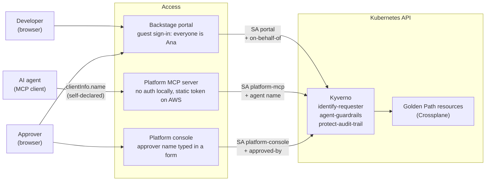
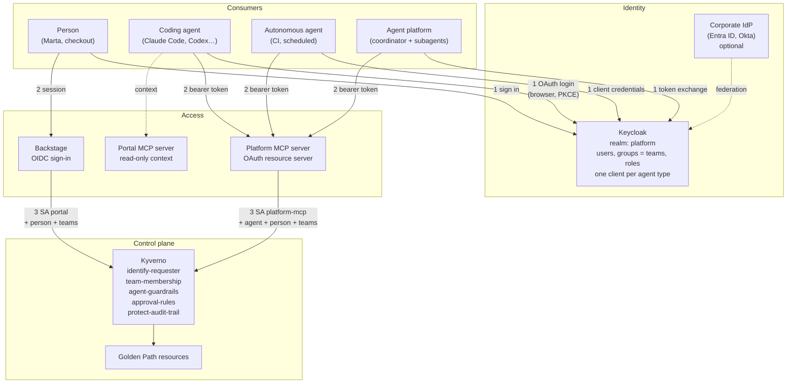
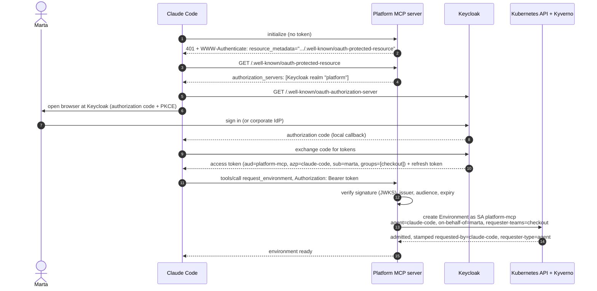
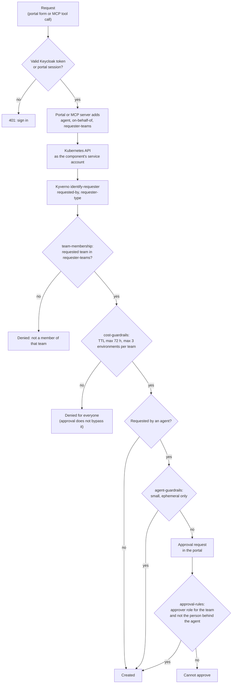
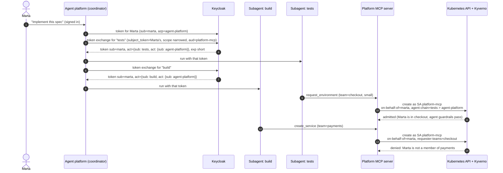
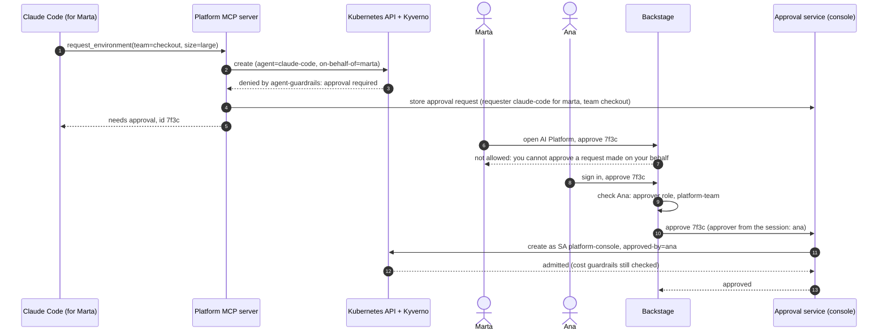

# Identity and access for humans and agents

> **Status: design.** This document describes how authentication and authorization work for people and AI agents in the starter kit. The [current state](#1-current-state) section describes what the repository does today. Everything after it is the **target design** for the *Identity & access* component of the *Optimize* milestone, and is not implemented yet. The [implementation plan](#9-implementation-plan) says what comes first.

The platform answers three questions for every request, whoever sends it:

1. **Who is acting?** A person, an agent, or an agent working for a person.
2. **On whose behalf, and for which team?** The person and team who are accountable, and who pay.
3. **What may they do?** The same Golden Paths and guardrails for everyone, plus stricter guardrails for agents, and human approval where the risk requires it.

The principle behind the design: **an agent never has more permissions than the person it works for, and usually has fewer**, because the agent guardrails apply on top.

## Contents

1. [Current state](#1-current-state)
2. [Target architecture](#2-target-architecture)
3. [Identities](#3-identities)
4. [Authentication](#4-authentication)
5. [Authorization](#5-authorization)
6. [Backstage](#6-backstage)
7. [Delegation between agents](#7-delegation-between-agents)
8. [Use cases](#8-use-cases)
9. [Implementation plan](#9-implementation-plan)
10. [Open questions](#10-open-questions)

---

## 1. Current state

Today every request reaches the Kubernetes API through one of a few platform service accounts. Kyverno stamps the request with its author, and requester and approval annotations cannot be forged or changed afterwards ([`10-identify-requester.yaml`](../platform/governance/policies/10-identify-requester.yaml), [`30-agent-guardrails.yaml`](../platform/governance/policies/30-agent-guardrails.yaml)).

What already works and is kept:

- The requester type (human or agent) comes from the **service account** that calls the API, not from the client.
- Only the portal can set `on-behalf-of`, only the console can set `approved-by`, and neither can be changed after creation.
- An agent cannot approve its own request. Agents only get small environments and only deploy into ephemeral (`env-*`) namespaces.
- Approvals in the portal already use the signed-in Backstage user, not a typed name.

What is missing:

| Gap | Where | Consequence |
|---|---|---|
| The agent name is what the MCP client says about itself (`clientInfo.name`, or `unknown-agent`) | [`mcp_server.py`](../platform/access/mcp/platform_mcp/mcp_server.py), `agent_name()` | Any client can claim to be `claude-code`. All agents share one service account |
| The MCP server does not know which person the agent works for | Same | The audit trail says "an agent", not "Marta's agent" |
| `team` is a free parameter | `request_environment(team=...)` and portal forms | Anyone, human or agent, can request resources for, and charge cost to, any team |
| Platform MCP authentication is none (local) or one shared static token (AWS) | `BearerToken`, `MCP_TOKEN` | No per-agent or per-person revocation |
| The portal signs everyone in as the guest Ana | [`app-config.yaml`](../platform/access/portal/app-config.yaml), `signIn` module | The approver is always Ana |
| The console accepts the approver name from the request body | [`console.py`](../platform/access/mcp/platform_mcp/console.py), `decide()` | An approval can be recorded under someone else's name |
| No roles | — | Anyone can approve any request; no segregation of duties |

---

## 2. Target architecture

**Keycloak** becomes the identity provider and authorization server of the platform. It issues the tokens that the portal and the platform MCP server trust. In a customer it brokers the corporate identity provider (Entra ID, Okta…), so people sign in with their usual account while the platform receives tokens with the teams and roles it understands.

Three trust boundaries, each with one job:

| Boundary | Trusts | Checks |
|---|---|---|
| **Keycloak** | The person's credentials (or the corporate IdP), and each registered agent client | Who the person is, which agent client is acting, which teams and roles apply |
| **Portal and platform MCP server** | Tokens signed by Keycloak (issuer, audience, signature, expiry) | Turn the token into identity annotations on the request. They never take identity from tool arguments or form fields |
| **Kyverno** | Only the platform service accounts (`portal`, `platform-mcp`, `platform-console`, Argo CD) | Who may set which identity annotation, team membership, agent guardrails, approval rules, and that the trail cannot change |

Kubernetes RBAC stays coarse (each platform component has one service account). Fine-grained decisions stay in Kyverno, as code and with tests, for humans and agents alike.

---

## 3. Identities

| Identity | Example | How it authenticates | Accountable person | Permissions |
|---|---|---|---|---|
| **Person** | Marta, team checkout | Keycloak sign-in (or corporate IdP through Keycloak) in the portal | Herself | Her teams and roles |
| **Agent on behalf of a person** | Claude Code used by Marta | OAuth authorization code with PKCE against Keycloak; the person signs in once in the browser | The person | The person's teams and roles, **plus** the agent guardrails |
| **Subagent** | A test subagent launched by a coordinator for Marta | Token exchange from the coordinator's token | The person at the start of the chain | At most the coordinator's, usually narrowed to its task |
| **Autonomous agent** | `ci-agent`, a nightly clean-up agent | Client credentials (confidential client in Keycloak) | Its owner team (a client attribute) | Its own roles, scoped to its owner team, plus the agent guardrails |
| **Platform component** | Portal, MCP server, console, Argo CD | Kubernetes service account | — | Only what its job needs. Kyverno trusts the identity annotations that each one is allowed to set |

Teams are Keycloak **groups** (`checkout`, `payments`, `platform-team`), with the same names as the Backstage catalog groups. Roles are Keycloak **realm roles**: `developer` (implicit for every member) and `approver`. An approver approves for the teams they belong to; members of `platform-team` with `approver` can approve for every team.

Each agent **type** is a Keycloak client (`claude-code`, `codex`, `gemini-cli`, `ci-agent`, or an agent platform). The client id that appears in the token (`azp`) is the agent identity, so it can no longer be declared by the client itself. An organization can disable one agent type, or one person's use of an agent, without touching the platform.

---

## 4. Authentication

### 4.1 People in the portal

Backstage uses Keycloak through its OIDC provider instead of the guest provider. The sign-in resolver maps the Keycloak username to the catalog `User` entity (`user:default/marta`) and its group memberships. The portal backend then knows the signed-in person for every action, as it already does for approvals.

In a customer, Keycloak brokers the corporate IdP. People see their usual sign-in page; Keycloak maps their corporate groups to platform teams.

### 4.2 Agents acting for a person: OAuth on the platform MCP server

The platform MCP server becomes an **OAuth 2.1 resource server**, as described by the [MCP authorization specification](https://modelcontextprotocol.io/specification/2025-06-18/basic/authorization). MCP clients such as Claude Code already implement the client side: when the server answers `401`, they discover the authorization server, open the browser for the person to sign in, and retry with a bearer token.

Client registration: Keycloak can register MCP clients dynamically, but anonymous dynamic registration needs its client registration policies relaxed. The starter kit pre-creates one public client per agent type in the realm and configures it in the client (`claude mcp add ... --client-id claude-code`). Dynamic registration stays an option.

Access tokens are short-lived (5 minutes) and refreshed by the client. This keeps revocation close to immediate without calling Keycloak on every request.

### 4.3 Autonomous agents

An agent with no person behind it (CI, a scheduled job, `make demo-agent`) uses the OAuth **client credentials** grant with a confidential client. The token has no person: `sub` is the client's service account, and the owner team comes from a client attribute mapped into the token. It is always treated as an agent, so the agent guardrails apply.

### 4.4 Platform components

Portal, MCP server, console and Argo CD keep authenticating to Kubernetes with their **service accounts**. Kyverno decides which identity annotations each one may set. This is what makes the stamp unforgeable: a person or agent never talks to the Kubernetes API directly through the platform.

### 4.5 The token

The platform MCP server only accepts access tokens issued by the platform realm for its own audience.

| Claim | Example | Used for |
|---|---|---|
| `iss` | `https://<host>/realms/platform` | Only tokens from this realm are accepted |
| `aud` | `platform-mcp` | Tokens issued for other services are rejected |
| `azp` | `claude-code` | The agent identity (the OAuth client) |
| `sub`, `preferred_username` | `marta` | The person the agent works for. For client credentials, the client's service account |
| `groups` | `["checkout"]` | Teams the request may target |
| `realm_access.roles` | `["developer"]` | Roles such as `approver` |
| `act` | `{"sub": "coordinator", "act": {...}}` | Chain of agents in delegation (section 7) |
| `exp` | 5 minutes after issue | Short-lived; refreshed by the client |

---

## 5. Authorization

Authorization happens in layers. Each layer does one thing, and the last word is always the policy engine, as code and with tests.

### 5.1 Policies

| Policy | Applies to | Rule | Status |
|---|---|---|---|
| `identify-requester` | Everyone | Stamps `requested-by` and `requester-type` from the authenticated identity | Exists; extended to record the person behind an agent |
| `team-membership` | Everyone | `spec.team` (or the owner team) must be one of `requester-teams`. Autonomous agents: only their owner team | **New** |
| `cost-guardrails` | Everyone | TTL at most 72 hours, at most 3 active environments per team | Exists |
| `agent-guardrails` | Agents | Small environments only, deploy only into `env-*`, never self-approve | Exists |
| `approval-rules` | Approvals | Approver role for the request's team (or `platform-team` approver), and not the person on whose behalf the agent acted (four eyes) | **New**; enforced in the portal backend and in the console |
| `protect-audit-trail` | Everyone | Only the portal sets `on-behalf-of`; only the MCP server sets `agent`, `agent-chain` and `requester-teams` for agents; only the console sets `approved-by`; nothing changes after creation | Exists; extended with the new annotations |

Team membership is checked in Kyverno, not only in the MCP server or the portal, so that both channels obey the same rule and the rule has tests.

### 5.2 Audit trail

Every resource carries who asked, for whom, through which channel, and who approved. These annotations are what the catalog and the AI Platform page show.

| Annotation | Set by | Example |
|---|---|---|
| `platform.starterkit.dev/requested-by` | Kyverno | `claude-code` |
| `platform.starterkit.dev/requester-type` | Kyverno | `agent` |
| `platform.starterkit.dev/agent` | Platform MCP server, from `azp` | `claude-code` |
| `platform.starterkit.dev/on-behalf-of` | Portal or platform MCP server, from `sub` | `marta` |
| `platform.starterkit.dev/requester-teams` | Portal or platform MCP server, from `groups` | `checkout` |
| `platform.starterkit.dev/agent-chain` | Platform MCP server, from `act` | `test-runner > coordinator > agent-platform` |
| `platform.starterkit.dev/approved-by` | Console (approval service) | `ana` |
| `platform.starterkit.dev/delivered-by` | Kyverno | `api` or `gitops` |

Approvals and decisions are also recorded as Kubernetes events with the actor, as today.

---

## 6. Backstage

Backstage is connected to Keycloak in two ways.

| Connection | What it does | In the MVP |
|---|---|---|
| **Sign-in (OIDC)** | Replaces the guest provider. The person signs in with Keycloak (or the corporate IdP through it) and is resolved to their catalog `User`. Every portal action carries that person: templates set `on-behalf-of`, approvals use the signed-in user | Yes |
| **Organization sync** | The Keycloak catalog module from the Backstage community plugins loads users and groups into the catalog, so `org.yaml` is no longer maintained by hand and catalog teams are the token's teams | No: names are kept equal by hand |

Inside the portal:

- **Templates** (environment, Spring service, Angular app, capabilities) offer only the teams of the signed-in person, and Kyverno enforces the same rule.
- **Approvals** on the AI Platform page show the *Approve* button only to people allowed by the approval rules. The portal backend checks the role and calls the approval service; it never forwards a typed name.
- **Catalog cards** show "requested by claude-code on behalf of Marta (checkout), approved by Ana".
- The **portal MCP server** (read-only context for agents) keeps its static token in the MVP. Moving it to Keycloak tokens, with the same audience model as the platform MCP server, is a later step.

The platform console stays as a read-only backup screen. Its approval endpoint only accepts calls from the portal backend (or requires a Keycloak token with the approver role), never a name in the request body.

---

## 7. Delegation between agents

When an agent platform runs a coordinator that launches subagents, everything they do is **on behalf of the person** who invoked the coordinator. Each subagent still has **its own identity**, so the trail says who actually acted.

The standard mechanism is OAuth 2.0 **token exchange** ([RFC 8693](https://www.rfc-editor.org/rfc/rfc8693)). The coordinator exchanges its token for a narrower one for each subagent. The subject stays the person, and the `act` claim records the chain of actors.

Rules that follow:

- **Permissions only go down the chain.** A subagent never has more than the coordinator, and the coordinator never more than the person.
- **The trail keeps the whole chain**, for example "environment requested by `tests`, delegated by `agent-platform`, on behalf of Marta (checkout)".
- **Four eyes covers the chain.** Marta cannot approve what any agent acting for her requested.
- **Autonomous agents are not delegated**: they have their own identity and an owner team.

Where the chain is built is a boundary decision. When several subagents share one MCP connection (for example, subagents inside one Claude Code session), the platform only sees one agent on behalf of the person. Distinguishing each subagent is the agent platform's job (it performs the token exchange); the developer platform verifies the chain and enforces the rules. An agent platform is registered in Keycloak as one more client, allowed to exchange tokens.

---

## 8. Use cases

The scenarios use the sample organization of the demo: **Ana** (`platform-team`, approver), **Marta** (`checkout`) and **Luis** (`payments`, approver).

| # | Scenario | Channel | Identity in the token | Result | Recorded as |
|---|---|---|---|---|---|
| 1 | Marta creates a medium environment for checkout, 48 h | Portal | Marta, groups `checkout` | Created | requested-by `marta`, type `human` |
| 2 | Marta creates an environment for payments | Portal | Marta, groups `checkout` | **Denied**: not a member of payments | Denied event, actor `marta` |
| 3 | Marta's Claude Code asks for a small environment for checkout | MCP | `azp=claude-code`, `sub=marta` | Created | requested-by `claude-code`, type `agent`, on-behalf-of `marta` |
| 4 | Marta's Claude Code asks for an environment for payments | MCP | Same | **Denied**: the agent inherits Marta's teams, no escalation | Denied event, actor `claude-code` for `marta` |
| 5 | Marta's Claude Code asks for a large environment | MCP | Same | Sent to approval. Marta **cannot** approve it (four eyes). Ana approves | requested-by `claude-code`, on-behalf-of `marta`, approved-by `ana` |
| 6 | Luis tries to approve scenario 5 | Portal | Luis, `payments`, approver | **Cannot approve**: approver for payments, not checkout | — |
| 7 | An agent asks for a 2-week environment and Ana approves it | MCP, portal | — | **Denied** at creation: the 72 h limit applies to everyone, approval does not bypass it | Approval status `failed` |
| 8 | A client sends `team`, `on-behalf-of` or `approved-by` in its own request | MCP or direct | Any | Ignored (identity comes from the token) or **denied** by `protect-audit-trail` | — |
| 9 | Nightly `ci-agent` (owner team checkout) cleans and recreates an environment | MCP | Client credentials, `azp=ci-agent`, owner `checkout` | Created, only for checkout | requested-by `ci-agent`, type `agent`, no person |
| 10 | Coordinator with three subagents implements a spec for Marta | MCP | Exchanged tokens, `sub=marta`, `act` chain | Each subagent limited to Marta's teams and the agent guardrails | agent-chain `tests > agent-platform`, on-behalf-of `marta` |
| 11 | Marta's laptop is lost: the security team disables her Claude Code sessions in Keycloak | MCP | Refresh fails, token expires within 5 min | **401** on the next call after expiry | — |
| 12 | An unregistered MCP client or an expired token calls the server | MCP | None or invalid | **401** with the resource metadata to sign in | — |
| 13 | Customer with Entra ID: Marta signs in with her corporate account | Portal, MCP | Keycloak federates Entra ID; groups mapped to teams | Same as scenarios 1–5 | Same |
| 14 | A service created by Marta's agent is delivered through GitOps | Argo CD | Service account of Argo CD | Agent guardrails still apply (only `env-*`) | `service-created-by` from the repository, delivered-by `gitops` |

### Scenario 5 in detail: approval with four eyes

### Demo moment

In act 2 of the demo, the *Identify* step becomes visible, in about three minutes:

1. In Claude Code, `/mcp` shows the platform server asking for authentication. The browser opens the Keycloak sign-in (with the portal branding) and the presenter signs in as Marta.
2. "I need an environment to test the new checkout discount rules." The catalog shows *requested by claude-code on behalf of Marta (checkout)* (scenario 3).
3. "Create another one for payments." Denied: Marta's agent cannot do what Marta cannot do (scenario 4).
4. "Now a large one for a load test." Marta cannot approve it; the presenter signs in as Ana and approves (scenario 5).
5. Optional: disable the `claude-code` client or Marta's session in Keycloak and show the next call failing (scenario 11).

---

## 9. Implementation plan

Two increments, each usable on its own. No code is changed by this document.

| Increment | Scope | Repository areas |
|---|---|---|
| **A. Agents with identity** | Keycloak with the demo realm (local and AWS); OAuth resource server on the platform MCP server; identity from the token (`azp`, `sub`, `groups`); new annotations; `team-membership` policy with Kyverno tests; `ci-agent` for `make demo-agent` | New `platform/access/identity/` (Keycloak deployment and realm export), `platform/access/mcp/`, `platform/governance/policies/`, `deploy/install.sh`, `deploy/local`, `deploy/aws`, `.mcp.json` and client adapters |
| **B. People with identity** | Backstage OIDC sign-in; approval rules (role and four eyes) in the portal backend and console; read-only console; catalog card and AI Platform page with *on behalf of*; documentation and demo script | `platform/access/portal/`, `platform/access/mcp/platform_mcp/console.py`, `examples/scenarios/`, `README.md` |

Out of scope for this component's MVP:

- Secrets management (Vault, External Secrets).
- Token exchange towards other systems, for example creating the Gitea repository as Marta instead of `platform-admin`.
- Kubernetes impersonation, so that the MCP server acts in the API as the person, with RBAC per team namespace. It is the natural next step.
- Roles per environment beyond ephemeral environments (the demo has no permanent environments).
- Organization sync from Keycloak into the catalog.
- OAuth on the portal MCP server.

Checks to keep green: `python3 deploy/check-repository.py`, `make test`, the Kyverno policy tests, and the demo acts on `make up` and `make aws-up`.

---

## 10. Open questions

- **`act` claim in Keycloak.** Standard token exchange is available in recent Keycloak versions (26.2 and later). Whether it emits the `act` claim for delegation has to be validated with the version used. If it does not, the agent platform can pass the chain and the MCP server records it, with less assurance.
- **Client registration.** Pre-created clients per agent type (proposed) or dynamic client registration. To be validated with the Claude Code version used in the demo.
- **Issuer and hostnames.** The browser and the cluster must see the same Keycloak issuer URL (locally `localhost`, on AWS the load balancer with the demo CA), or tokens will not validate.
- **Four eyes always or configurable.** Proposed: enabled in the demo, configurable in the kit.
- **Immediate revocation.** Short-lived tokens give revocation within minutes. Token introspection in the MCP server would make it immediate at the cost of one call to Keycloak per request.
