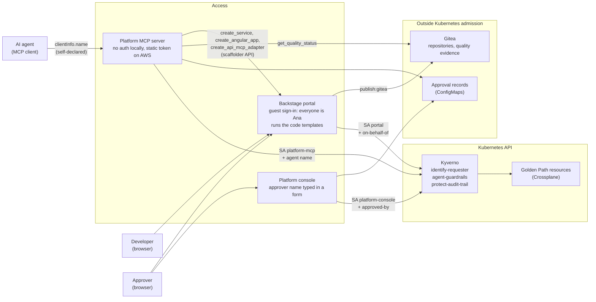
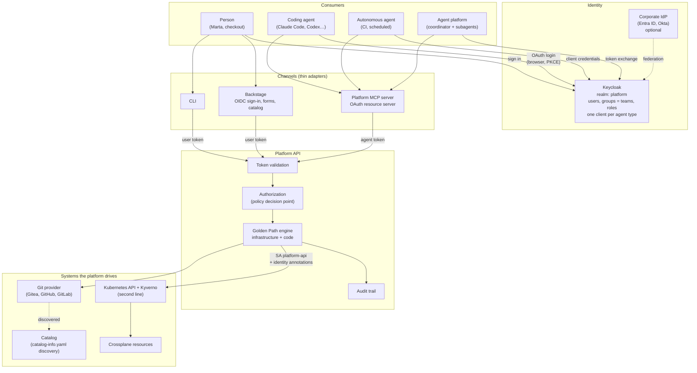
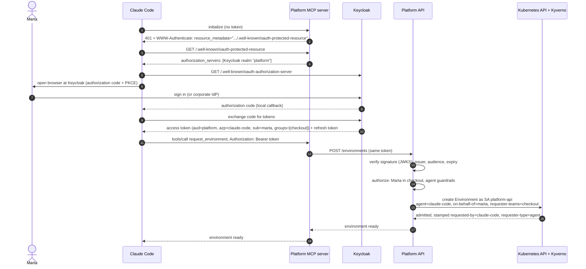
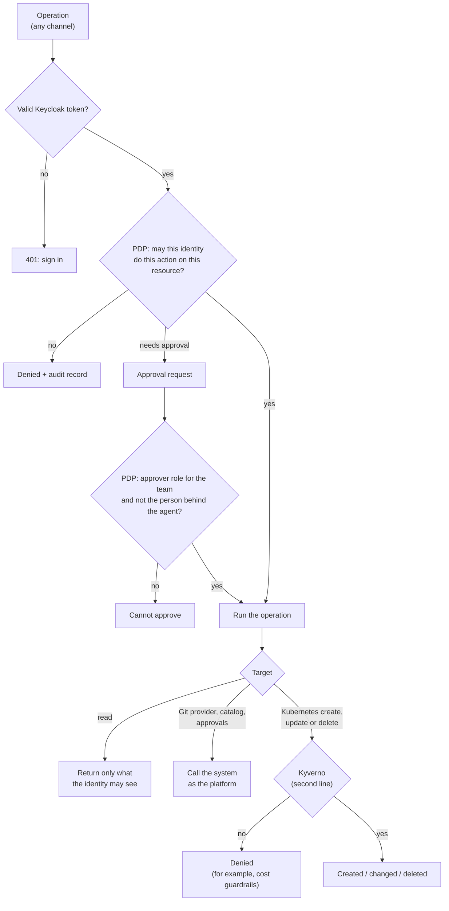
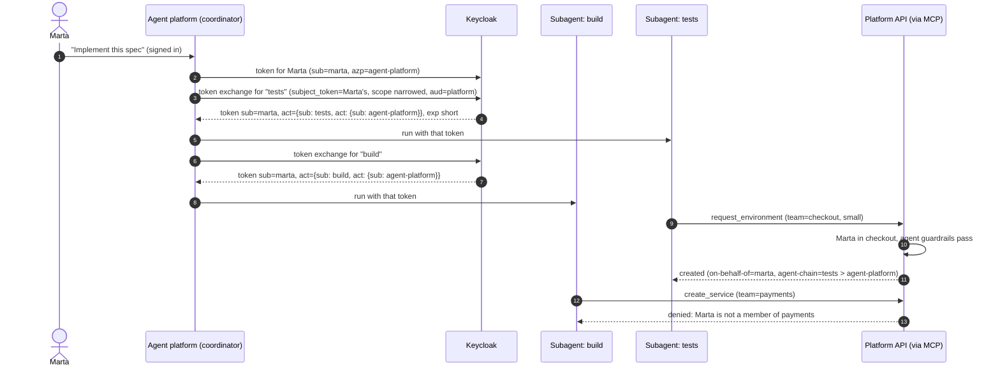
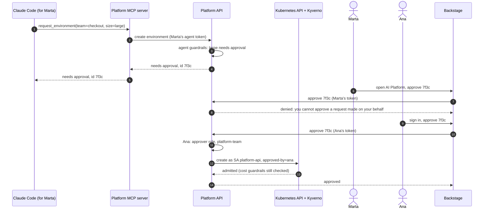
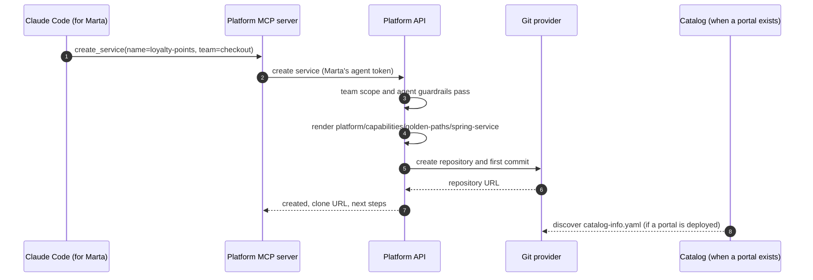

# Identity and access for humans and agents

> **Status: design.** This document describes how authentication and authorization work for people and AI agents in the starter kit. The [current state](#1-current-state) section describes what the repository does today. Everything after it is the **target design** for the *Identity & access* component of the *Optimize* milestone, and is not implemented yet. The [implementation plan](#10-implementation-plan) says what comes first.

The platform answers three questions for every request, whoever sends it and through whichever channel:

1. **Who is acting?** A person, an agent, or an agent working for a person.
2. **On whose behalf, and for which team?** The person and team who are accountable, and who pay.
3. **What may they do?** The same Golden Paths and guardrails for everyone, plus stricter guardrails for agents, and human approval where the risk requires it.

Two principles behind the design:

- **An agent never has more permissions than the person it works for, and usually has fewer**, because the agent guardrails apply on top.
- **Capabilities do not depend on a channel.** Identity, authorization and the Golden Paths live in a platform API. The portal, the MCP server and the CLI are thin adapters on top of it, so a capability works the same with a portal, without one (zero-UI), or with a different portal.

## Contents

1. [Current state](#1-current-state)
2. [Target architecture](#2-target-architecture)
3. [Platform API](#3-platform-api)
4. [Identities](#4-identities)
5. [Authentication](#5-authentication)
6. [Authorization](#6-authorization)
7. [Backstage](#7-backstage)
8. [Delegation between agents](#8-delegation-between-agents)
9. [Use cases](#9-use-cases)
10. [Implementation plan](#10-implementation-plan)
11. [Open questions](#11-open-questions)

---

## 1. Current state

### 1.1 Identity

Requests that create platform resources reach the Kubernetes API through one of a few platform service accounts. Kyverno stamps the request with its author, and requester and approval annotations cannot be forged or changed afterwards ([`10-identify-requester.yaml`](../platform/governance/policies/10-identify-requester.yaml), [`30-agent-guardrails.yaml`](../platform/governance/policies/30-agent-guardrails.yaml)).

What already works and is kept:

- The requester type (human or agent) comes from the **service account** that calls the API, not from the client.
- Only the portal can set `on-behalf-of`, only the console can set `approved-by`, and neither can be changed after creation.
- An agent cannot approve its own request. Agents only get small environments and only deploy into ephemeral (`env-*`) namespaces.
- Approvals in the portal already use the signed-in Backstage user, not a typed name.

What is missing in identity:

| Gap | Where | Consequence |
|---|---|---|
| The agent name is what the MCP client says about itself (`clientInfo.name`, or `unknown-agent`) | [`mcp_server.py`](../platform/access/mcp/platform_mcp/mcp_server.py), `agent_name()` | Any client can claim to be `claude-code`. All agents share one service account |
| The MCP server does not know which person the agent works for | Same | The audit trail says "an agent", not "Marta's agent" |
| `team` is a free parameter | `request_environment(team=...)` and portal forms | Anyone, human or agent, can request resources for, and charge cost to, any team |
| Platform MCP authentication is none (local) or one shared static token (AWS) | `BearerToken`, `MCP_TOKEN` | No per-agent or per-person revocation |
| The portal signs everyone in as the guest Ana | [`app-config.yaml`](../platform/access/portal/app-config.yaml), `signIn` module | The approver is always Ana |
| The console accepts the approver name from the request body | [`console.py`](../platform/access/mcp/platform_mcp/console.py), `decide()` | An approval can be recorded under someone else's name |
| No roles | — | Anyone can approve any request; no segregation of duties |

### 1.2 Authorization outside Kubernetes admission

Kyverno only sees what is **created or updated** in the Kubernetes API. Many platform operations never go through it:

| Operation (platform MCP tool) | What it touches | Checked by Kyverno today? |
|---|---|---|
| `request_environment`, `deploy_service`, `request_capability` | Crossplane resources (create) | Yes |
| `delete_environment` | Crossplane resource (delete) | **No**: the policies match `CREATE` and `UPDATE` only. Any agent can delete any team's environment |
| `create_service`, `create_angular_app`, `create_api_mcp_adapter` | Backstage scaffolder, Gitea repository, catalog | **No**, except the `SpringService`/`App` that GitOps delivers later |
| Approve or reject a request | Approval ConfigMap, then a create as `platform-console` | Only the final create |
| `list_environments`, `get_environment`, `get_capability_request`, `get_service_status`, `get_approval_status` | Reads from Kubernetes, Argo CD, pipelines | **No** (reads never go through admission) |
| `get_quality_status` | Reads from Gitea | **No** |
| Portal MCP server (catalog, standards, team usage) | Backstage catalog | **No** |

### 1.3 Coupling to Backstage

Infrastructure Golden Paths are channel-independent: their API is Crossplane, and the portal and the MCP server both call it. **Code Golden Paths are not.** The skeletons live in [`platform/capabilities/golden-paths/`](../platform/capabilities/golden-paths), but they are executed by the Backstage scaffolder (`fetch:template` and `publish:gitea`). The platform MCP server runs them through the scaffolder API ([`portal.py`](../platform/access/mcp/platform_mcp/portal.py)).

| Capability | Works without Backstage? |
|---|---|
| Environments, deployment, databases, approvals, delivery and quality status | Yes |
| New Spring service, Angular app, API-to-MCP adapter | **No**: the MCP tools fail with "portal not reachable" (and `PORTAL=false` also skips Gitea) |
| Propose a new platform capability (pull request with its definition) | **No**: it only exists as a portal action (`platform:capability:propose`) |
| Context for agents (owners, standards, team usage) | **No**: it is the portal MCP server |

This contradicts the principle that the portal is an interface, not the platform: a zero-UI setup, or a different portal (Red Hat Developer Hub, a custom one), would lose those capabilities. It is also why authorization cannot live in one place today. The platform API in section 3 fixes both.

---

## 2. Target architecture

**Keycloak** becomes the identity provider and authorization server of the platform. It issues the tokens the platform trusts. In a customer it brokers the corporate identity provider (Entra ID, Okta…), so people sign in with their usual account while the platform receives tokens with the teams and roles it understands.

A **platform API** becomes the single entry point for every capability. It validates the token, makes the authorization decision and runs the Golden Path. The portal, the MCP server and the CLI become adapters.

Four trust boundaries, each with one job:

| Boundary | Trusts | Checks |
|---|---|---|
| **Keycloak** | The person's credentials (or the corporate IdP), and each registered agent client | Who the person is, which agent client is acting, which teams and roles apply |
| **Channels** (portal, MCP server, CLI) | The user or agent session | Obtain and forward the token. They hold no business rules and never take identity from tool arguments or form fields |
| **Platform API** | Tokens signed by Keycloak (issuer, audience, signature, expiry) | Every authorization decision, for reads and writes, inside and outside Kubernetes. Turns the token into identity annotations |
| **Kyverno** | Only the platform API's service account (and Argo CD for GitOps delivery) | Second line on what reaches Kubernetes: guardrails, team membership, approval and audit-trail rules |

---

## 3. Platform API

The platform API is the channel-independent core. It owns what today is spread between the MCP server package ([`platform.py`](../platform/access/mcp/platform_mcp/platform.py), [`delivery.py`](../platform/access/mcp/platform_mcp/delivery.py), [`quality.py`](../platform/access/mcp/platform_mcp/quality.py)), the console and the Backstage scaffolder actions.

| Responsibility | What it does |
|---|---|
| **Authentication** | Validates Keycloak access tokens and builds the request identity: agent, person, teams, roles, delegation chain |
| **Authorization** | Calls the policy decision point (section 6) for every operation, read or write, before touching any system |
| **Infrastructure Golden Paths** | Creates, reads and deletes Crossplane resources (environments, services, capabilities), with identity annotations |
| **Code Golden Paths** | Renders the skeletons in `platform/capabilities/golden-paths/` and creates the repository through the Git provider API. The repository's `catalog-info.yaml` registers it in the catalog by discovery, so no portal call is needed |
| **Capability proposals** | Opens the pull request with a capability definition (today `platform:capability:propose`) |
| **Approvals** | Stores approval requests and records decisions with the authenticated approver (today the console) |
| **Audit** | Records every decision, allowed or denied, with the full identity |

Consequences for each channel:

- **MCP server:** each tool maps to one platform API operation. No direct calls to Kubernetes, Gitea or the scaffolder.
- **Backstage:** the Software Templates stay as **forms** (what people fill in), and their single step calls the platform API with the signed-in user's token (section 7). The catalog, TechDocs and the AI Platform page keep reading what they read today.
- **CLI:** a thin client of the same API, for automation and people who prefer the terminal.
- **Zero-UI:** an MCP client and the CLI are enough to use every capability. The portal is optional.

Where it lives in the repository (proposal): `platform/capabilities/api/`, as part of the Core Engineering layer, with the MCP server and the console reduced to adapters in `platform/access/`.

---

## 4. Identities

| Identity | Example | How it authenticates | Accountable person | Permissions |
|---|---|---|---|---|
| **Person** | Marta, team checkout | Keycloak sign-in (or corporate IdP through Keycloak) in the portal or the CLI | Herself | Her teams and roles |
| **Agent on behalf of a person** | Claude Code used by Marta | OAuth authorization code with PKCE against Keycloak; the person signs in once in the browser | The person | The person's teams and roles, **plus** the agent guardrails |
| **Subagent** | A test subagent launched by a coordinator for Marta | Token exchange from the coordinator's token | The person at the start of the chain | At most the coordinator's, usually narrowed to its task |
| **Autonomous agent** | `ci-agent`, a nightly clean-up agent | Client credentials (confidential client in Keycloak) | Its owner team (a client attribute) | Its own roles, scoped to its owner team, plus the agent guardrails |
| **Platform component** | Platform API, Argo CD | Kubernetes service account | — | Only what its job needs. Kyverno trusts the identity annotations that the platform API sets |

Teams are Keycloak **groups** (`checkout`, `payments`, `platform-team`), with the same names as the Backstage catalog groups. Roles are Keycloak **realm roles**: `developer` (implicit for every member) and `approver`. An approver approves for the teams they belong to; members of `platform-team` with `approver` can approve for every team.

Each agent **type** is a Keycloak client (`claude-code`, `codex`, `gemini-cli`, `ci-agent`, or an agent platform). The client id that appears in the token (`azp`) is the agent identity, so it can no longer be declared by the client itself. An organization can disable one agent type, or one person's use of an agent, without touching the platform.

---

## 5. Authentication

### 5.1 People in the portal and the CLI

Backstage uses Keycloak through its OIDC provider instead of the guest provider. The sign-in resolver maps the Keycloak username to the catalog `User` entity (`user:default/marta`). The portal backend forwards the person's access token to the platform API, so the platform sees the same identity whether Marta uses the portal, the CLI or an agent.

The CLI uses the OAuth device or authorization code flow against the same realm.

In a customer, Keycloak brokers the corporate IdP. People see their usual sign-in page; Keycloak maps their corporate groups to platform teams.

### 5.2 Agents acting for a person: OAuth on the platform MCP server

The platform MCP server becomes an **OAuth 2.1 resource server**, as described by the [MCP authorization specification](https://modelcontextprotocol.io/specification/2025-06-18/basic/authorization). MCP clients such as Claude Code already implement the client side: when the server answers `401`, they discover the authorization server, open the browser for the person to sign in, and retry with a bearer token. The MCP server forwards the token to the platform API, which validates it and decides.

Client registration: Keycloak can register MCP clients dynamically, but anonymous dynamic registration needs its client registration policies relaxed. The starter kit pre-creates one public client per agent type in the realm and configures it in the client (`claude mcp add ... --client-id claude-code`). Dynamic registration stays an option.

Access tokens are short-lived (5 minutes) and refreshed by the client. This keeps revocation close to immediate without calling Keycloak on every request.

### 5.3 Autonomous agents

An agent with no person behind it (CI, a scheduled job, `make demo-agent`) uses the OAuth **client credentials** grant with a confidential client. The token has no person: `sub` is the client's service account, and the owner team comes from a client attribute mapped into the token. It is always treated as an agent, so the agent guardrails apply.

### 5.4 Platform components

The platform API and Argo CD authenticate to Kubernetes with their **service accounts**. Kyverno decides which identity annotations each one may set. People and agents never talk to the Kubernetes API, the Git provider or the scaffolder directly through the platform.

### 5.5 The token

The platform API only accepts access tokens issued by the platform realm for its audience.

| Claim | Example | Used for |
|---|---|---|
| `iss` | `https://<host>/realms/platform` | Only tokens from this realm are accepted |
| `aud` | `platform` | Tokens issued for other services are rejected |
| `azp` | `claude-code` | The agent identity (the OAuth client). For the portal or the CLI, the channel |
| `sub`, `preferred_username` | `marta` | The person. For client credentials, the client's service account |
| `groups` | `["checkout"]` | Teams the request may target or read |
| `realm_access.roles` | `["developer"]` | Roles such as `approver` |
| `act` | `{"sub": "coordinator", "act": {...}}` | Chain of agents in delegation (section 8) |
| `exp` | 5 minutes after issue | Short-lived; refreshed by the client |

---

## 6. Authorization

Authorization does **not** depend only on Kyverno. It is enforced in two lines:

1. **First line: the platform API's policy decision point (PDP).** Every operation, read or write, inside or outside Kubernetes, is checked before the platform touches any system. This is where the authorization model lives.
2. **Second line: Kyverno.** On top, for whatever reaches the Kubernetes API: the guardrails that are already there, plus team membership and audit-trail protection. If the first line has a bug, or something reaches Kubernetes another way (GitOps), the second line still holds.

### 6.1 Authorization model

Decisions take four inputs: **who** (identity type, person, agent, teams, roles, chain), **action** (`read`, `create`, `delete`, `approve`, `propose`), **resource** (kind and owner team) and **context** (size, TTL, target namespace). The rules are written once, as code, with tests, and used by every operation.

| Rule | Applies to | Decision |
|---|---|---|
| **Team scope** | Everyone | Create, read and delete only resources whose owner team is one of the requester's teams. `platform-team` reads everything. Autonomous agents: only their owner team |
| **Agent guardrails** | Agents | Small environments, deploy only into `env-*`, no repositories outside the team, never approve. Anything bigger becomes an approval request |
| **Delete** | Everyone | Only resources of your teams. Agents only what an agent of the same person (or the same autonomous agent) created |
| **Approval** | Approvals | Approver role for the request's team (or `platform-team` approver), and not the person on whose behalf the agent acted (four eyes) |
| **Proposals** | Capability definitions | Only members of `platform-team`; agents never propose or edit a definition |
| **Delegation** | Subagents | Never more than the token they were exchanged from |

How the rules are evaluated is an implementation choice: plain code with tests for the MVP, or a policy engine such as [Cedar](https://www.cedarpolicy.com/) or [OPA](https://www.openpolicyagent.org/) when the rules grow. Both keep them as code, versioned and tested.

### 6.2 Operations and where they are authorized

| Operation | First line (platform API) | Second line (Kyverno) |
|---|---|---|
| `request_environment`, `deploy_service`, `request_capability` | Team scope, agent guardrails | `identify-requester`, `team-membership`, `cost-guardrails`, `agent-guardrails`, `protect-audit-trail` |
| `delete_environment` | Team scope, delete rule | New: `DELETE` added to `team-membership` |
| `create_service`, `create_angular_app`, `create_api_mcp_adapter` | Team scope, agent guardrails, then the Git provider | The delivered `SpringService`/`App`, as today |
| Approve or reject | Approval rule | `protect-audit-trail` on the final create |
| Propose a capability | Proposal rule | — (a pull request, reviewed by a person) |
| `list_environments`, `get_environment`, `get_capability_request`, `get_service_status`, `get_approval_status`, `get_quality_status` | Team scope on reads: results filtered to the requester's teams | — |
| Portal MCP server (catalog, standards, team usage) | Backstage permission framework with the same team scope, or reads through the platform API | — |

### 6.3 Kyverno policies (second line)

| Policy | Rule | Status |
|---|---|---|
| `identify-requester` | Stamps `requested-by` and `requester-type` from the authenticated identity | Exists; reads the identity annotations set by the platform API |
| `team-membership` | Owner team in `requester-teams`, on create, update and delete | **New** |
| `cost-guardrails` | TTL at most 72 hours, at most 3 active environments per team | Exists |
| `agent-guardrails` | Small environments only, deploy only into `env-*`, never self-approve | Exists |
| `protect-audit-trail` | Only the platform API sets `agent`, `on-behalf-of`, `requester-teams`, `agent-chain` and `approved-by`; nothing changes after creation | Exists; extended with the new annotations |

### 6.4 Audit trail

Every resource carries who asked, for whom, through which channel, and who approved. These annotations are what the catalog and the AI Platform page show. Denied operations, including reads and operations outside Kubernetes, are recorded by the platform API.

| Annotation | Set by | Example |
|---|---|---|
| `platform.starterkit.dev/requested-by` | Kyverno | `claude-code` |
| `platform.starterkit.dev/requester-type` | Kyverno | `agent` |
| `platform.starterkit.dev/agent` | Platform API, from `azp` | `claude-code` |
| `platform.starterkit.dev/on-behalf-of` | Platform API, from `sub` | `marta` |
| `platform.starterkit.dev/requester-teams` | Platform API, from `groups` | `checkout` |
| `platform.starterkit.dev/agent-chain` | Platform API, from `act` | `test-runner > coordinator > agent-platform` |
| `platform.starterkit.dev/approved-by` | Platform API (approvals) | `ana` |
| `platform.starterkit.dev/delivered-by` | Kyverno | `api` or `gitops` |

Repositories created by code Golden Paths carry the same information in their `catalog-info.yaml` and first commit.

---

## 7. Backstage

Backstage is one channel among others. It connects to Keycloak and to the platform API, and nothing breaks if it is not deployed.

| Connection | What it does | In the MVP |
|---|---|---|
| **Sign-in (OIDC)** | Replaces the guest provider. The person signs in with Keycloak (or the corporate IdP through it) and is resolved to their catalog `User` | Yes |
| **Platform API** | Templates, approvals and the AI Platform page call the platform API with the signed-in person's token. The portal makes no authorization decision of its own | Yes |
| **Organization sync** | The Keycloak catalog module from the Backstage community plugins loads users and groups into the catalog, so `org.yaml` is no longer maintained by hand | No: names are kept equal by hand |

Inside the portal:

- **Software Templates** stay as forms. Their single step calls the platform API (for example `platform:service:create`) instead of `fetch:template` and `publish:gitea`. The skeletons are rendered by the platform API, so the result is identical from the portal, the MCP server or the CLI.
- **Approvals** on the AI Platform page show the *Approve* button only when the platform API says the person may approve.
- **Catalog cards** show "requested by claude-code on behalf of Marta (checkout), approved by Ana". New repositories appear by discovery of their `catalog-info.yaml`.
- The **portal MCP server** (read-only context for agents) keeps its static token in the MVP. Moving it to Keycloak tokens with the same team scope is a later step.

The platform console becomes a read-only backup screen.

---

## 8. Delegation between agents

When an agent platform runs a coordinator that launches subagents, everything they do is **on behalf of the person** who invoked the coordinator. Each subagent still has **its own identity**, so the trail says who actually acted.

The standard mechanism is OAuth 2.0 **token exchange** ([RFC 8693](https://www.rfc-editor.org/rfc/rfc8693)). The coordinator exchanges its token for a narrower one for each subagent. The subject stays the person, and the `act` claim records the chain of actors.

Rules that follow:

- **Permissions only go down the chain.** A subagent never has more than the coordinator, and the coordinator never more than the person.
- **The trail keeps the whole chain**, for example "environment requested by `tests`, delegated by `agent-platform`, on behalf of Marta (checkout)".
- **Four eyes covers the chain.** Marta cannot approve what any agent acting for her requested.
- **Autonomous agents are not delegated**: they have their own identity and an owner team.

Where the chain is built is a boundary decision. When several subagents share one MCP connection (for example, subagents inside one Claude Code session), the platform only sees one agent on behalf of the person. Distinguishing each subagent is the agent platform's job (it performs the token exchange); the developer platform verifies the chain and enforces the rules. An agent platform is registered in Keycloak as one more client, allowed to exchange tokens.

---

## 9. Use cases

The scenarios use the sample organization of the demo: **Ana** (`platform-team`, approver), **Marta** (`checkout`) and **Luis** (`payments`, approver).

| # | Scenario | Channel | Identity in the token | Result | Recorded as |
|---|---|---|---|---|---|
| 1 | Marta creates a medium environment for checkout, 48 h | Portal | Marta, groups `checkout` | Created | requested-by `marta`, type `human` |
| 2 | Marta creates an environment for payments | Portal | Marta, groups `checkout` | **Denied**: not a member of payments | Denied, actor `marta` |
| 3 | Marta's Claude Code asks for a small environment for checkout | MCP | `azp=claude-code`, `sub=marta` | Created | requested-by `claude-code`, type `agent`, on-behalf-of `marta` |
| 4 | Marta's Claude Code asks for an environment for payments | MCP | Same | **Denied**: the agent inherits Marta's teams, no escalation | Denied, actor `claude-code` for `marta` |
| 5 | Marta's Claude Code asks for a large environment | MCP | Same | Sent to approval. Marta **cannot** approve it (four eyes). Ana approves | requested-by `claude-code`, on-behalf-of `marta`, approved-by `ana` |
| 6 | Luis tries to approve scenario 5 | Portal | Luis, `payments`, approver | **Cannot approve**: approver for payments, not checkout | Denied, actor `luis` |
| 7 | An agent asks for a 2-week environment and Ana approves it | MCP, portal | — | **Denied** at creation: the 72 h limit applies to everyone, approval does not bypass it | Approval status `failed` |
| 8 | A client sends `on-behalf-of` or `approved-by` in its own request | MCP or direct | Any | Ignored (identity comes from the token) and **denied** by `protect-audit-trail` if it reaches Kubernetes | — |
| 9 | Marta's agent lists environments | MCP | `sub=marta` | Only checkout environments are returned | — |
| 10 | Marta's agent reads the quality status of a payments service | MCP | `sub=marta` | **Denied** by team scope, although it is not a Kubernetes resource | Denied, actor `claude-code` for `marta` |
| 11 | Marta's agent deletes a payments environment | MCP | `sub=marta` | **Denied** by the platform API, and by Kyverno if it gets that far (today it would succeed) | Denied |
| 12 | Zero-UI: Backstage is not deployed and Marta's agent creates a Spring service | MCP | `sub=marta` | Created: the platform API renders the skeleton and creates the repository. It appears in the catalog when a portal is added | requested-by `claude-code`, on-behalf-of `marta` |
| 13 | Nightly `ci-agent` (owner team checkout) cleans and recreates an environment | MCP | Client credentials, `azp=ci-agent`, owner `checkout` | Created, only for checkout | requested-by `ci-agent`, type `agent`, no person |
| 14 | Coordinator with three subagents implements a spec for Marta | MCP | Exchanged tokens, `sub=marta`, `act` chain | Each subagent limited to Marta's teams and the agent guardrails | agent-chain `tests > agent-platform`, on-behalf-of `marta` |
| 15 | Marta's laptop is lost: the security team disables her Claude Code sessions in Keycloak | MCP | Refresh fails, token expires within 5 min | **401** on the next call after expiry | — |
| 16 | An unregistered MCP client or an expired token calls the server | MCP | None or invalid | **401** with the resource metadata to sign in | — |
| 17 | Customer with Entra ID: Marta signs in with her corporate account | Portal, MCP, CLI | Keycloak federates Entra ID; groups mapped to teams | Same as scenarios 1–5 | Same |
| 18 | A service created by Marta's agent is delivered through GitOps | Argo CD | Service account of Argo CD | Agent guardrails still apply (only `env-*`) | `service-created-by` from the repository, delivered-by `gitops` |

### Scenario 5 in detail: approval with four eyes

### Scenario 12 in detail: zero-UI

### Demo moment

In act 2 of the demo, the *Identify* step becomes visible, in about three minutes:

1. In Claude Code, `/mcp` shows the platform server asking for authentication. The browser opens the Keycloak sign-in (with the portal branding) and the presenter signs in as Marta.
2. "I need an environment to test the new checkout discount rules." The catalog shows *requested by claude-code on behalf of Marta (checkout)* (scenario 3).
3. "Create another one for payments." Denied: Marta's agent cannot do what Marta cannot do (scenario 4).
4. "Now a large one for a load test." Marta cannot approve it; the presenter signs in as Ana and approves (scenario 5).
5. Optional: disable the `claude-code` client or Marta's session in Keycloak and show the next call failing (scenario 15).

The zero-UI story (scenario 12) can close the demo: the same capabilities with the portal switched off.

---

## 10. Implementation plan

Three increments, each usable on its own. No code is changed by this document.

| Increment | Scope | Repository areas | Estimate |
|---|---|---|---|
| **0. Platform API, channel-independent** | Extract the core from the MCP server package into a platform API; render code Golden Paths and create repositories without the Backstage scaffolder; move capability proposals and approvals into it; MCP server and console become adapters; Backstage templates call the API. Prerequisite for authorization in one place and for zero-UI | New `platform/capabilities/api/`, `platform/access/mcp/`, `platform/access/portal/plugins/`, Golden Path templates | 4–6 days |
| **A. Agents with identity** | Keycloak with the demo realm (local and AWS); OAuth resource server on the platform MCP server; token validation and the authorization model in the platform API (team scope on reads and writes, delete rule); `team-membership` Kyverno policy with tests; new annotations; `ci-agent` for `make demo-agent` | New `platform/access/identity/` (Keycloak deployment and realm export), `platform/capabilities/api/`, `platform/governance/policies/`, `deploy/install.sh`, `deploy/local`, `deploy/aws`, `.mcp.json` and client adapters | 6–8 days |
| **B. People with identity** | Backstage OIDC sign-in, forwarding the person's token; approval rules (role and four eyes); read-only console; catalog card and AI Platform page with *on behalf of*; documentation and demo script | `platform/access/portal/`, `platform/access/mcp/platform_mcp/console.py`, `examples/scenarios/`, `README.md` | About 4 days |

The estimates are for one person working with an agent, without a prototype.

Out of scope for this component's MVP:

- Secrets management (Vault, External Secrets).
- Token exchange towards other systems, for example creating the Git repository as Marta instead of a platform account.
- Kubernetes impersonation, so that the platform API acts in the Kubernetes API as the person, with RBAC per team namespace.
- Roles per environment beyond ephemeral environments (the demo has no permanent environments).
- Organization sync from Keycloak into the catalog.
- OAuth and team scope on the portal MCP server.

Checks to keep green: `python3 deploy/check-repository.py`, `make test`, the Kyverno policy tests, and the demo acts on `make up` and `make aws-up`, including with `PORTAL=false` once increment 0 is done.

---

## 11. Open questions

- **Policy decision point.** Plain code with tests for the MVP, or Cedar or OPA from the start. Proposed: code first, behind one interface, so the engine can change without touching the operations.
- **Git provider without the portal.** `PORTAL=false` also skips Gitea today. Zero-UI needs the Git server (and delivery) to be installed independently of the portal.
- **Template format.** The skeletons use the Backstage template syntax (Nunjucks). The platform API needs a renderer compatible with it, or the skeletons move to a neutral format that Backstage forms can still use.
- **`act` claim in Keycloak.** Standard token exchange is available in recent Keycloak versions (26.2 and later). Whether it emits the `act` claim for delegation has to be validated with the version used. If it does not, the agent platform can pass the chain and the platform API records it, with less assurance.
- **Client registration.** Pre-created clients per agent type (proposed) or dynamic client registration. To be validated with the Claude Code version used in the demo.
- **Issuer and hostnames.** The browser and the cluster must see the same Keycloak issuer URL (locally `localhost`, on AWS the load balancer with the demo CA), or tokens will not validate.
- **Four eyes always or configurable.** Proposed: enabled in the demo, configurable in the kit.
- **Immediate revocation.** Short-lived tokens give revocation within minutes. Token introspection in the platform API would make it immediate at the cost of one call to Keycloak per request.
